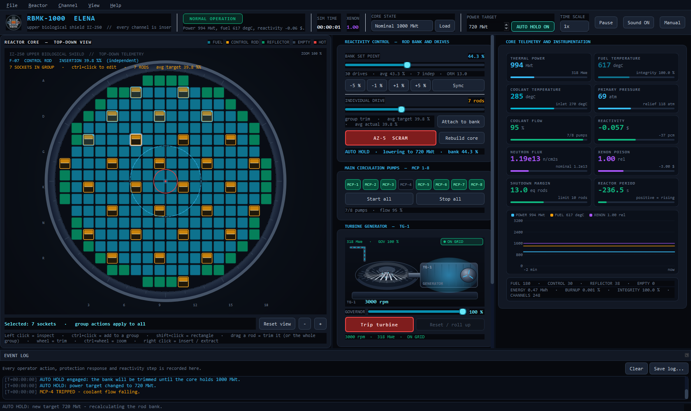
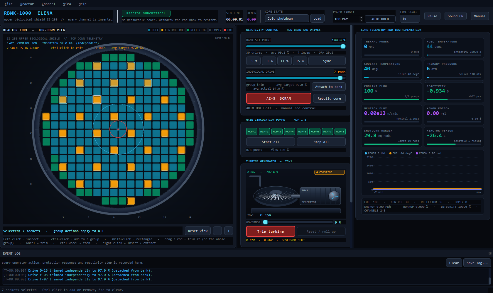
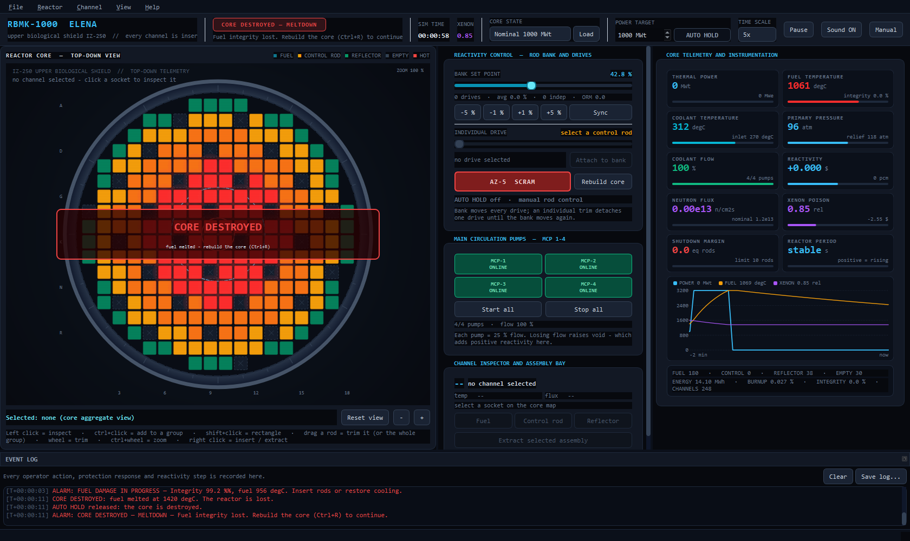

# RBMK Nuclear Reactor Simulator

**An interactive educational control-room sandbox inspired by the RBMK-1000**, built
with C++17 and Qt 6 for students, educators, and researchers exploring simplified
reactor dynamics and human–machine interaction.

> **Safety and research notice:** This is an educational, simplified model, not a
> validated reactor-physics code, a digital twin, an operator training system, or a
> source of real-world operating procedures. Do not use its outputs for reactor
> operation, engineering design, safety analysis, or quantitative research conclusions
> without independent verification and validation against appropriate reference data.

## At a glance

- Explore an interactive channel map, individual control rods, coolant pumps, and scram.
- Observe simulated power, reactivity, temperature, xenon, and operating margin.
- Compare nominal, low-power, and cold-shutdown starting states.
- Inspect and test a UI-independent physics engine alongside the Qt control room.
- Build a 64-bit Windows installer or run directly from a local build.

## Screenshots

### Control room — nominal starting state



### Control room — cold-shutdown starting state



### Control room — simulated meltdown



These images were generated with the application's automated screenshot mode. The
nominal and cold captures exercise controls, so displayed selections and settings are
not necessarily the untouched preset defaults. The meltdown capture uses the automated
demonstration scenario. Values can vary between runs.

## Overview

A native Qt 6 / C++17 control-room simulator built from the single-file HTML prototype
(`rbmk_nuclear_reactor_simulator.html`). It is **a sandbox, not a mission game**: there
are no objectives, no scripted faults and no score. The reactor simply responds to what
you do to it, and instability (positive void feedback, xenon poisoning, loss of shutdown
margin, prompt criticality, fuel damage) is an emergent consequence of those choices.

Every one of the 248 core sockets is a physical channel that can be emptied or reloaded
with a fuel bundle, a control rod drive or a water reflector column, and **all 30 control
rod drives can be moved independently** of the bank. An automatic power controller can
hold any megawatt you dial in, by solving the rod-worth curve against the live core.

## Build

Requirements: Qt 6.5+ (tested with Qt 6.8.3 MSVC2022 x64), CMake 3.21+, a C++17 compiler
(tested with MSVC 2022), Ninja (or any CMake generator).

```powershell
# from a Visual Studio developer shell (vcvars64.bat)
cmake -S . -B build -G Ninja -DCMAKE_PREFIX_PATH=C:/Qt/6.8.3/msvc2022_64 -DCMAKE_BUILD_TYPE=Release
cmake --build build

# optional: copy the Qt runtime next to the executable so it runs by double-click
cmake --build build --target deploy

# Ensure the Qt DLLs are available to the test executable; adjust to your Qt installation.
$env:PATH = "C:\Qt\6.8.3\msvc2022_64\bin;$env:PATH"
# unit tests (22 tests: kinetics, rods, xenon, cooling, cold start, meltdown, power hold)
ctest --test-dir build --output-on-failure
```

Run:

```powershell
.\build\RBMK-Control-Room.exe
.\build\RBMK-Control-Room.exe --preset cold      # start from cold shutdown
.\build\RBMK-Control-Room.exe --hold 700        # open with the power hold at 700 MWt
.\build\RBMK-Control-Room.exe --selftest --screenshot shot.png
.\build\RBMK-Control-Room.exe --demo meltdown   # educational excursion demo
```

## Windows installer

Build the Release executable first using the instructions above. Then, from the
project directory, run:

```powershell
powershell -ExecutionPolicy Bypass -File .\installer\build-installer.ps1
```

The script stages only the executable and its Qt runtime, then builds
`out\RBMK-Control-Room-Setup-1.0.0.exe` using Inno Setup 6. It defaults to the
Qt 6.8.3 MSVC x64 location shown above and `build\vc_redist.x64.exe`; use
`-QtBin`, `-RedistPath`, `-BuildDir`, or `-IsccPath` to override those paths.
Provide the official Microsoft Visual C++ x64 Redistributable appropriate for
the compiler used to build the application. The installer requires administrator
rights, installs the redistributable if needed, and creates a Start menu shortcut
with an optional desktop shortcut. The resulting installer is for 64-bit Windows.
The installer is not digitally signed.

## Controls

| Action | Result |
| --- | --- |
| Left click a socket | select / inspect the channel |
| **Ctrl + click a socket** | add / remove it from a **multi-selection** (cyan ring, primary keeps the amber ring) |
| **Shift + click** | select the whole rectangle between the anchor and that socket |
| Drag a control rod socket up or down | withdraw / insert that drive, or every drive in the group by the same amount |
| Mouse wheel over a control rod | trim that drive by 3 % (the whole group when it is part of a selection) |
| `+` / `-`, individual drive slider | trim the selected drive(s) together |
| Ctrl + wheel, `+` / `-` buttons | zoom the core map |
| Double click empty space | reset the zoom to 100 % |
| Right click a socket | insert / extract assemblies, preset a rod drive (acts on the whole group) |
| Arrow keys | move the channel selection (clears the group) |
| **POWER TARGET + AUTO HOLD** | the controller trims the bank to hold the selected megawatt |
| `Ctrl+H` | engage / release the automatic power hold |
| `Ctrl+Shift+H` | hold the power the reactor is at right now |
| Bank slider, `-5/-1/+1/+5 %`, Ctrl+Up/Down | move the whole rod bank (releases AUTO HOLD) |
| Individual drive slider | trim only the selected rod (detaches it from the bank) |
| AZ-5 SCRAM, `F2` | drop every installed rod to 100 % |
| `P` | pause / resume |
| `Ctrl+R` | rebuild the core in the current starting state |
| `Ctrl+A` | select every installed rod drive |
| `Esc` | clear the multi-selection |
| `Ctrl+C` | copy the selected channels (coord, type, trim, temperature) to the clipboard |
| `Ctrl+1/2/3` | install fuel / control rod / reflector in every selected socket |
| `Ctrl+E` | extract the selected assemblies |
| `Ctrl+B` | re-attach the selected drives to the bank |
| `F1` | operating manual (also in Help → Operating manual) |

## Automatic power hold

The app opens with **AUTO HOLD** engaged on the running core. Type the megawatt you
want in the header (`POWER TARGET`) and the controller takes the bank:

* every physics step it computes a reactivity bias proportional to `ln(target / power)`,
  capped at ±0.30 $ so it can never approach prompt criticality, and then **solves the
  rod-worth curve** (bisection over 0–100 %) for the bank position that produces that
  bias on the *measured* core — xenon, void, fuel temperature, burnup and the actual
  per-drive worth all included;
* the bias falls to zero as the power reaches the target, so the core ends up genuinely
  critical at the requested megawatt and stays there while xenon drifts underneath it;
* it only moves drives attached to the bank, at the normal 14 %/s drive speed, so it is
  an operator aid rather than a cheat — you can still trim individual drives, and the
  solve accounts for them;
* moving the bank by hand releases it at once, as does an AZ-5 scram, and it refuses to
  engage while a scram is still dropping the rods; loading a core state re-targets it at
  that state's nominal power (a cold core loads with it off);
* if the target is unreachable the status line in the rod card says which limit was hit
  (rod worth exhausted, or xenon/void holding the core down) and the bank parks at it.

`Ctrl+Shift+H` grabs the current power as the target, which is the quickest way to make
a drifting reactor stable.

## Physics model

Implemented in `src/core/ReactorCore.cpp` (no UI dependencies, unit tested):

* **Reactivity in dollars** (`1 $ = beta_eff = 0.0065`) built from fuel inventory,
  radially weighted control-rod worth (S-curve), xenon, fuel-temperature feedback,
  void fraction, burnup and the AZ-5 scram transient.
* **Point kinetics** reduced to the stable root of the one-group inhour equation
  (`rho = Lambda*s + beta*s/(s+lambda)`, solved by bisection every tick), so prompt
  criticality above `+1 $` grows on the prompt lifetime and subcritical states decay
  on the delayed-neutron period.
* **Iodine / xenon dynamics** with the post-shutdown xenon peak.
* **Positive void coefficient**: losing coolant flow raises reactivity, which is the
  mechanism that makes pump trips dangerous.
* **Two-node thermal hydraulics** (fuel + coolant) with four switchable main circulation
  pumps, saturation-pressure-based primary pressure, a relief valve at 118 atm and a
  pipe-rupture limit above 140 atm.
* **Core damage**: fuel damage accumulates above 900 degC, the core is destroyed above
  1500 degC and must be rebuilt.
* **Per-channel read-out**: local temperature and flux are derived from radial peaking
  and the shadowing of nearby inserted control rods, so pulling one rod visibly heats
  the channels around it.
* **Operating reactivity margin** (ORM) in equivalent fully-inserted rods with warnings
  below 10 and critical below 6; with a low ORM the AZ-5 graphite displacers add the
  historical positive scram transient.

The numbers are internally consistent and tuned around plausible RBMK behaviour, but
this is an educational model, not a validated reactor-physics code or an operating
procedure.

## Using the simulator for education and research

For a reproducible classroom exercise or exploratory study:

1. Record the source revision, operating system, compiler, Qt version, and build settings.
2. Select a starting preset and document any subsequent control actions and time scale.
3. Change one simulated input at a time and compare the on-screen trends and event log.
4. Save the event log using the control-room interface and retain screenshots alongside
   your notes. The event log is not a complete substitute for recording the setup.
5. Inspect the implementation and tests, state the model's assumptions, and independently
   validate any findings before drawing conclusions beyond this sandbox.

The model uses reduced point kinetics and simplified thermal hydraulics rather than a
validated spatial, multi-physics representation. The UI's local channel readings are
derived estimates. Numerical values, controller behavior, and simulated failure scenarios
should be treated as illustrative rather than predictions of a real plant.

## License and reuse

The simulator is free to use, including for commercial, educational, and research
purposes. Modifying the project's own code or materials requires prior written
permission from the applicable copyright holder, subject to applicable law. The
license does not grant redistribution rights outside GitHub. See [LICENSE](LICENSE)
for the full terms and contact the repository owner to request permission.

This is source-available proprietary software, not an open-source license. Qt and
other third-party components have their own licenses and may grant additional rights
or impose distribution obligations independently of the project license.

## Source layout

```
src/core/ReactorTypes.h    channels, assemblies, telemetry, log entries
src/core/ReactorCore.h/cpp physics engine, rod drives, assembly exchange, alarms
src/ui/Theme.h/cpp         palette and stylesheet
src/ui/CoreView.h/cpp      painted 18x18 shield map, drag/wheel/context interaction
src/ui/GaugeCard.h/cpp     telemetry read-out card
src/ui/TrendChart.h/cpp    rolling power / fuel temperature / xenon strip chart
src/ui/MainWindow.h/cpp    control room layout, menus, inspector, event log
src/main.cpp               application entry, icon, --preset/--hold/--selftest/--screenshot
tests/core_tests.cpp       QtTest suite for the physics engine
```
